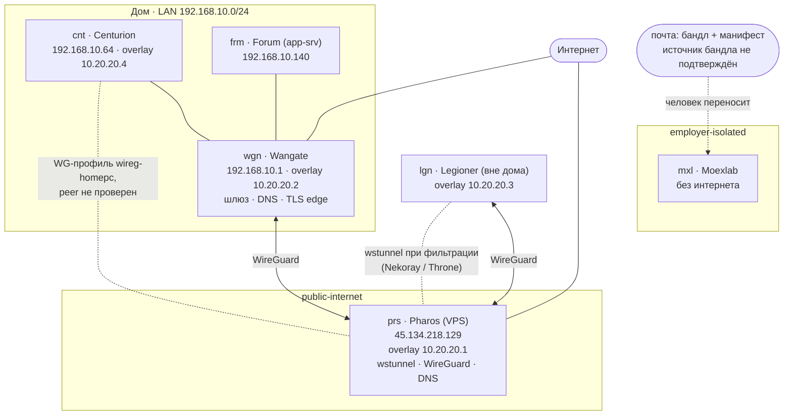

# 10 / 004. Доступ и сеть

Подробный файл области 10. Новых правил не вводит; нормы в `10-contours.md`, данные в `contours.yaml` (источник правды). Состояние на 2026-11-09, режим `draft`: факты взяты из документов репозиториев и прежних диалогов, по сети не проверялись.

## Схема

Сплошная линия: связь описана в документах. Пунктир: запасной путь, непроверенная связь или перенос человеком.



## Адресация

| Сеть | Диапазон | Статус |
|---|---|---|
| Домашняя LAN | `192.168.10.0/24` | current, после cutover 2026-11-02 |
| Старая домашняя LAN | `192.168.1.0/24` | historical (`192.168.1.203` Wangate, `192.168.1.64` Centurion) |
| Overlay WireGuard | `10.20.20.0/24` | current: `.1` Pharos, `.2` Wangate, `.3` Legioner, `.4` Centurion |

Спорные места, зафиксированные в реестре как открытые пункты: адрес `192.168.10.30` в README Wangate против `192.168.10.140` у Forum (OI-01) и устаревшие записи `192.168.1.x` в заметках PRODATA (OI-09).

## Пути доступа

Команды взяты из существующих инструкций; доступность портов и наличие ключей не проверялись. Единого SSH-runbook для Centurion, Legioner и Moexlab не найдено.

| Откуда | Куда | Путь |
|---|---|---|
| рабочая машина | `wgn` | SSH по ключу через overlay, пользователь `oista`, адрес `10.20.20.2` |
| рабочая машина | `prs` | SSH по ключу, пользователь `vpsops`, адрес `45.134.218.129`; ключ сервера не отключать |
| рабочая машина | `frm-appsrv` | SSH, пользователь `oista`, адрес `192.168.10.140`, порт 22 (исторически) |
| `lgn` вне дома | домашние узлы | WireGuard через `prs`; при фильтрации сети через wstunnel |
| любая | `mxl` | прямого доступа нет, образы доставляются по почте |

```powershell
# Wangate через overlay
ssh -i "$env:USERPROFILE\.ssh\id_ed25519" -o IdentitiesOnly=yes oista@10.20.20.2

# Pharos
ssh -i "$env:USERPROFILE\.ssh\vps\vps_eu" -o IdentitiesOnly=yes vpsops@45.134.218.129
```

Отпечатки серверов (`host_fingerprint`) в реестре пока `unknown`. Их нужно записать при первом проверенном подключении, а не принимать вслепую.

## Зоны

| Зона | Контуры | Смысл |
|---|---|---|
| `home-edge` | `wgn` | граница домашней сети и точка отказа всех домашних сервисов |
| `home-lan` | `cnt`, `frm` | доверенная домашняя сеть |
| `public-internet` | `prs` | публично доступный сервер; административные интерфейсы только по WG |
| `roaming` | `lgn` | сеть неизвестна и может фильтроваться |
| `employer-isolated` | `mxl` | рабочий контур без интернета |

## DNS

Для внутренних имён используются оба overlay DNS (Pharos и Wangate), а не публичный resolver. Приоритет между ними зависит от профиля клиента и подлежит отдельной проверке (OI-10).

## Что ещё не показано

На схеме нет сервисов (GitLab, Portainer, Kuma, мониторинг), потоков по портам и узла Proxmox с VM Home Assistant. Они добавятся после OI-01 и OI-04, когда будет подтверждено, что на каком узле работает.
